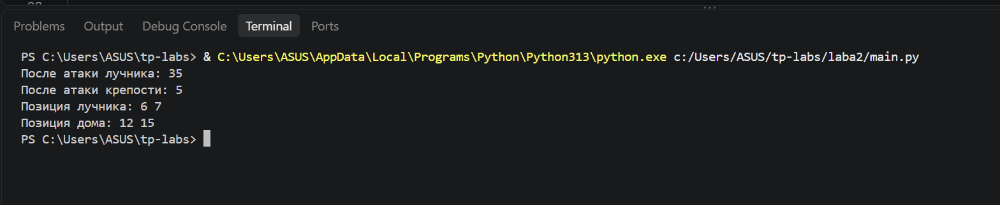

# Лабораторная работа № 2

**Дисциплина:** Технологии программирования

**Тема:** Основы объектно-ориентированного программирования

**Выполнила:** Хужамова Тасмина, БИВТ-25-4-6

## Цель работы

Применить принципы ООП при создании классов игровых объектов на Python.

## Задание

Реализовать базовые классы игрового объекта, юнита и постройки, их наследников и интерфейсы атаки и перемещения.

## Ход выполнения

В [`main.py`](main.py) класс `GameObject` хранит идентификатор, название и координаты. Его наследник `Unit` отвечает за здоровье и получение урона, а `Building` — за состояние постройки.

Атака и перемещение описаны отдельно в абстрактных классах `Attacker` и `Moveable`. Лучник умеет атаковать и перемещаться, крепость только атакует, а передвижной дом только меняет координаты.

## Проверка работы

Запуск из папки `laba2`:

```bash
python main.py
```

У противника было 50 единиц здоровья. После атаки лучника осталось 35, после атаки крепости — 5. Лучник переместился в точку (6, 7), а дом — в точку (12, 15).



## Вывод

Общие данные вынесены в базовый класс, а возможности объектов заданы отдельными интерфейсами. При запуске проверены атака и перемещение.
