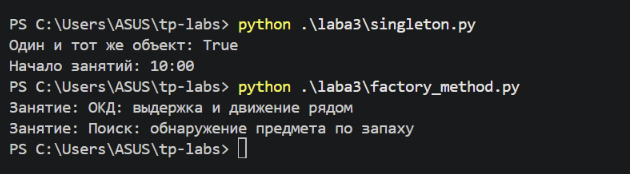
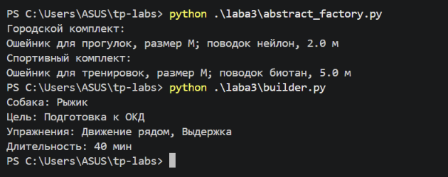

# Лабораторная работа № 3

**Дисциплина:** Технологии программирования

**Тема:** Порождающие паттерны проектирования

**Выполнила:** Хужамова Тасмина, БИВТ-25-4-6

## Цель работы

Изучить порождающие паттерны и реализовать четыре примера на Python.

## Задание

Реализовать Singleton, Factory Method, Abstract Factory и Builder.

## Ход выполнения

Для примеров выбрана предметная область кинологического клуба.

- `singleton.py` — единый объект с настройками клуба. Повторное создание возвращает тот же экземпляр.
- `factory_method.py` — создание занятия по ОКД или поисковой работе. Выбор класса занятия вынесен в фабричный метод курса.
- `abstract_factory.py` — создание комплектов амуниции для прогулок и тренировок: ошейник и поводок формируются одной фабрикой.
- `builder.py` — пошаговое составление плана тренировки с целью, упражнениями, оборудованием и длительностью. Отдельный директор не используется: порядок шагов задаёт вызывающий код.

## Проверка работы

Каждый пример запускается отдельно из папки `laba3`:

```bash
python singleton.py
python factory_method.py
python abstract_factory.py
python builder.py
```

Singleton вернул один экземпляр настроек при двух вызовах. Фабричный метод вывел описания занятий по ОКД и поиску.



Абстрактная фабрика создала городской и спортивный комплекты амуниции. Строитель собрал план тренировки Рыжика с двумя упражнениями на 40 минут.



## Вывод

Реализованы четыре порождающих паттерна. В примерах разделены создание объектов и их использование. Для плана тренировки показана пошаговая сборка.
