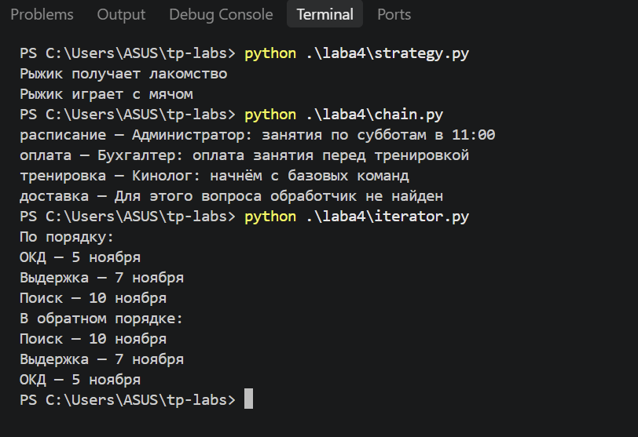

# Лабораторная работа № 4

**Дисциплина:** Технологии программирования

**Тема:** Поведенческие паттерны проектирования

**Выполнила:** Хужамова Тасмина, БИВТ-25-4-6

## Цель работы

Изучить поведенческие паттерны и реализовать их на Python.

## Задание

Реализовать Strategy, Chain of Responsibility и Iterator.

## Ход выполнения

Примеры связаны с работой кинологического клуба.

- `strategy.py` — выбор поощрения собаки после упражнения. Способ поощрения можно заменить во время работы без изменения класса занятия.
- `chain.py` — передача вопроса клиента между обработчиками расписания, оплаты и тренировок. Если никто не может ответить, возвращается сообщение об отсутствии обработчика.
- `iterator.py` — прямой и обратный обход журнала тренировок. Итератор хранит собственную позицию и копию списка занятий.

## Проверка работы

Каждый пример запускается отдельно из папки `laba4`:

```bash
python strategy.py
python chain.py
python iterator.py
```

Стратегия переключила поощрение с лакомства на игру. Цепочка обработала три известные темы и вернула сообщение об отсутствии обработчика для запроса «доставка». Итератор вывел три записи в прямом и обратном порядке.



## Вывод

Реализованы три поведенческих паттерна. Они позволяют изменять алгоритм поощрения, передавать запросы подходящему обработчику и обходить записи без доступа к внутреннему списку журнала.
